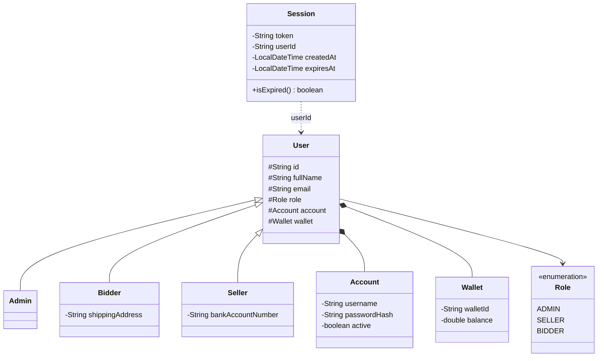
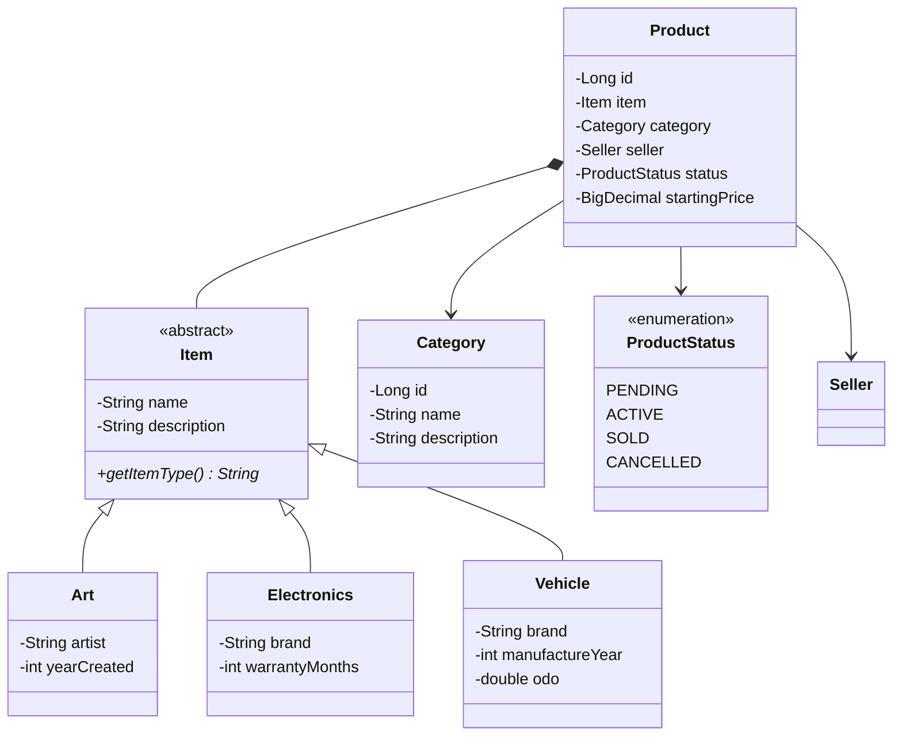
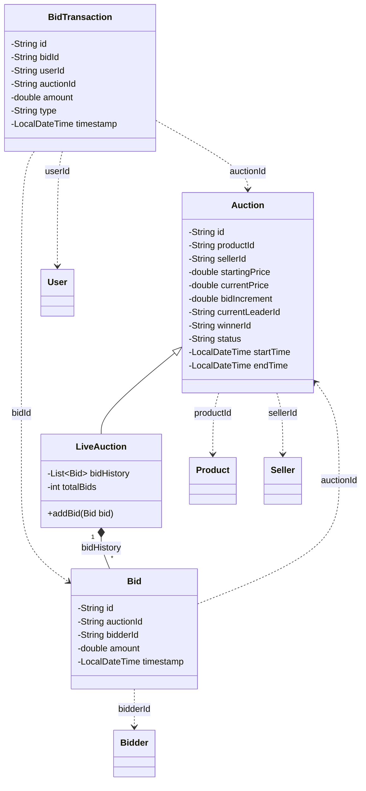
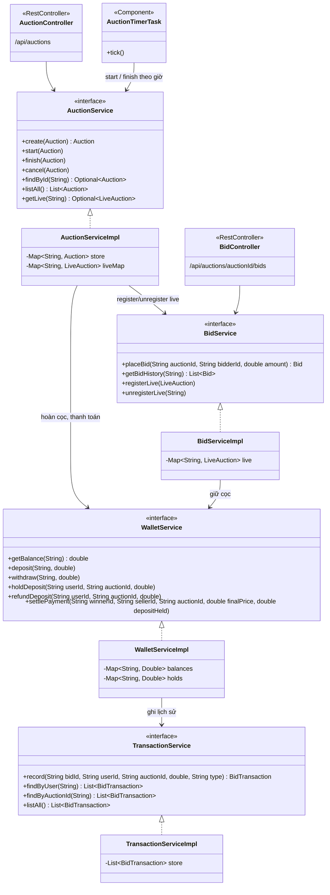

# Class Diagram — auction-server

Sơ đồ lớp của module `auction-server`, chia 4 phần: người dùng, sản phẩm, phiên đấu giá và giao dịch, tầng service/controller.

## 1. Người dùng & tài khoản

## 2. Sản phẩm & danh mục

## 3. Phiên đấu giá & giao dịch

- `status` của `Auction`: `OPEN → RUNNING → FINISHED → PAID`, hoặc `CANCELED`.
- `type` của `BidTransaction`: `DEPOSIT`, `WITHDRAW`, `HOLD`, `REFUND`, `PAYMENT`.
- Mũi tên nét đứt (`..>`) là liên kết qua id dạng `String`, không giữ object.

## 4. Service, controller & scheduler

### Luồng chính
1. `AuctionController.create`: phiên mới ở trạng thái `OPEN`.
2. `AuctionTimerTask` đến `startTime` thì gọi `start`: phiên chuyển `RUNNING` và được đăng ký vào `BidService`.
3. `BidController.placeBid` → `BidService` kiểm tra, rồi `WalletService.holdDeposit` giữ cọc lần đầu.
4. `AuctionTimerTask` đến `endTime` thì gọi `finish`: hoàn cọc người thua, `settlePayment` cho người thắng, phiên chuyển `PAID`.

## Chưa có nội dung (interface / class rỗng)
- Service: `UserService`, `AuthService`, `SessionService`, `PermissionService`, `ProductService`, `CategoryService`, `ProductSearchService` và các `*Impl`.
- Repository: `UserRepository`, `ProductRepository`, `CategoryRepository`, `AuctionRepository`, `BidRepository`.
- Socket server: `AuctionServer`, `ClientHandler`, `RequestRouter`.
- Controller: `AuthController`, `ProductController`, `AdminProductController`.
